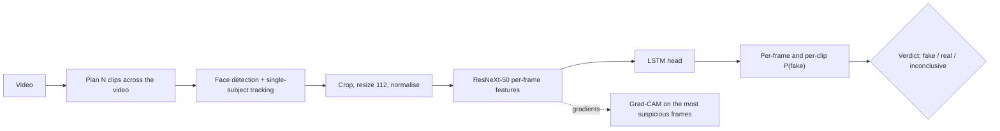

# 🕵️ Deepfake Video Detection

[](https://github.com/duclld1709/DeepFake-Video-Detection/actions/workflows/ci.yml)


**Check a suspicious video before you trust it.** Upload a clip, get a *fake / real / inconclusive*
verdict, a timeline of how suspicious each moment is, and Grad-CAM heatmaps showing which facial
regions drove the decision. It ships as a Python library, a CLI, a REST API and a web UI.

> Deepfake video calls impersonating relatives or officials are a growing scam pattern. Most victims
> don't need a research paper. They need a second opinion in seconds, plus an honest "I'm not sure"
> when the evidence is weak. This project is built around that use case.

---

## Highlights

| | |
|---|---|
| **Model** | ResNeXt-50 frame encoder + LSTM head (originally a DAP391m course project). The published checkpoint loads without changes. |
| **Whole-video analysis** | Samples several clips across the video instead of only the first ~3 s. Per-clip and per-frame P(fake), with max-clip score to catch partially manipulated videos. |
| **Explainability** | Grad-CAM on the most suspicious frames. Exact gradients, and memory scales with explained frames rather than clip length. |
| **Honest output** | An `inconclusive` band around the threshold, face-coverage reporting, and warnings when the setup differs from training (e.g. a different face detector). |
| **Serving** | FastAPI with upload limits, typed errors (415/413/422/503), a concurrency guard, health check and timing headers. Gradio UI and a CLI on top of the same code. Docker image. |
| **Training & evaluation** | Leakage-free group splits, recompression augmentation, AUC-based model selection, a held-out test set, and an end-to-end robustness benchmark (H.264 CRF, downscale, FPS). |
| **Quality** | 42 tests (model compatibility, pipeline, API, training smoke test), ruff, GitHub Actions CI. |

## Quickstart

```bash
git clone https://github.com/duclld1709/DeepFake-Video-Detection.git
cd DeepFake-Video-Detection
python -m venv .venv && source .venv/bin/activate
pip install -e ".[api,ui,dlib]"          # drop `dlib` to use the OpenCV face detector instead
pip install gdown && python scripts/download_weights.py   # -> weights/80_frame
```

```bash
# CLI
deepfake-detect analyze path/to/video.mp4 --explain-dir cams/   # add --json for the full result

# REST API -> http://localhost:8000/docs
deepfake-detect serve-api

# Web UI -> http://localhost:7860
python app.py
```

Docker (CPU):

```bash
docker build -t deepfake-detector .
docker run -p 8000:8000 -v "$PWD/weights:/app/weights" deepfake-detector              # API
docker run -p 7860:7860 -v "$PWD/weights:/app/weights" deepfake-detector serve-ui     # UI
```

All settings can be overridden with `DEEPFAKE_*` environment variables (see
[`config.py`](deepfake_detector/config.py)), e.g. `DEEPFAKE_NUM_CLIPS=5`, `DEEPFAKE_DEVICE=cuda`,
`DEEPFAKE_FACE_BACKEND=opencv`, `DEEPFAKE_THRESHOLD=0.6`.

## API

```bash
curl -F "file=@video.mp4" "http://localhost:8000/v1/analyze?num_clips=3&explain=4"
```

```jsonc
{
  "verdict": "fake",                    // fake | real | inconclusive
  "fake_probability": 0.87,             // mean over clips
  "max_clip_fake_probability": 0.95,
  "confidence": 0.87,
  "clips":  [{"index": 0, "start_s": 0.0, "end_s": 3.2, "frames_used": 80, "fake_probability": 0.81}, ...],
  "frames": [{"frame_index": 0, "timestamp_s": 0.0, "fake_probability": 0.78, "box": [40, 263, 98, 205]}, ...],
  "explanations": [{"frame_index": 187, "timestamp_s": 7.48, "overlay_png_base64": "iVBOR..."}],
  "face_coverage": 0.99,
  "warnings": [],
  "timings": {"faces_ms": 3765, "inference_ms": 2900, "explain_ms": 764, "total_ms": 7429}
}
```

| Status | Meaning |
|---|---|
| 400 | file is not a decodable video |
| 413 | upload or duration over the limit (`DEEPFAKE_MAX_UPLOAD_MB`, `DEEPFAKE_MAX_DURATION_S`) |
| 415 | unsupported extension |
| 422 | not enough frames with a visible face |
| 503 | model not loaded (see `/health`) or server busy |

## How it works



1. **Clip planning.** The video is split into `num_clips` segments. From the start of each, the analyzer
   reads consecutive frames until it has `sequence_length` (80) face crops.
2. **Face tracking.** The analyzer starts from the largest face, then follows the box that overlaps the
   previous one. (v1 took `faces[0]`, which can jump between people.) Detection runs on a frame
   downscaled to 640 px for speed.
3. **Classification.** Every analysed frame gets a score, and so does every clip. The video score is the
   mean over clips; the max is reported too.
4. **Explanation.** Grad-CAM targets the fake-vs-real log-odds. Only the selected frames are
   re-encoded with gradients.

## Engineering audit of v1 → v2

Rebuilding the project surfaced several bugs in the original code. Each fix is pinned by a test.

| # | v1 issue | Impact | v2 fix |
|---|---|---|---|
| 1 | `nn.LSTM` built without `batch_first=True` but fed `(batch, seq, feat)` | **No temporal modelling at inference.** The LSTM saw one time step and 80 "samples". During training (batch=2) the hidden state **leaked between two different videos**. | `legacy` mode reproduces the checkpoint's behaviour exactly, without the leak. `sequence` mode adds real recurrence for new training. Tests: `test_legacy_mode_reproduces_original_inference`, `test_original_leaks_across_batch_but_legacy_does_not` |
| 2 | `nn.LSTM(..., lstm_layers, bidirectional)`: the 4th positional argument is `bias` | The LSTM silently had no bias | Explicit keyword arguments. `lstm_bias=False` is auto-detected for old checkpoints |
| 3 | Dropout applied to the **logits** | Noisy training signal | Dropout on features, before the classifier. State dict unchanged |
| 4 | AUC computed from hard labels | Under-reported, meaningless AUC | AUC/EER from probabilities, plus ECE for calibration |
| 5 | Random per-video split; fakes share source videos | Validation accuracy (the reported 90%) likely inflated by leakage | Group-aware splits, held-out test set, cross-dataset protocol |
| 6 | Crash (`torch.stack([])`) when no face is found; `except: continue` | 500 errors, silent failures | `NoFaceDetectedError` → HTTP 422, coverage reported |
| 7 | Only the first ~80 frames (~3 s) analysed | Manipulations later in the video were missed | Multiple clips across the whole video |
| 8 | Hard-coded `torch.cuda.LongTensor`; `input()` prompt in training | Could not run on CPU or in automation | Device-agnostic, fully CLI-driven |
| 9 | `demo.launch(share=True)` on start; weights loaded from cwd | Public link by default; brittle deploy | Opt-in sharing, configurable weights path, `/health` endpoint |

One v1 behaviour is kept on purpose. Frames go to the model in **BGR** order, the way OpenCV decoded
them during training. Converting to RGB would look like a fix, but it would shift the input
distribution the weights were trained on.

## Training

```bash
pip install -e ".[train]"
# 1. Face-crop raw videos with the same detector/tracker used at inference (no train/serve skew)
python -m training.extract_faces --input-dir data/raw --output-dir data/faces
# 2. metadata.csv: file,label,group   (group = source video or identity -> no leakage across splits)
python -m training.train --metadata data/metadata.csv --video-root data/faces \
    --output-dir runs/exp1 --temporal-mode sequence --epochs 20 --amp
# fine-tune the published checkpoint instead of starting from ImageNet:
#   --init-from weights/80_frame
```

Outputs: `best.pt` (weights, spec and validation metrics), `history.json`, `summary.json` (test
metrics) and the split file lists for reproducibility.

## Evaluation protocol

```bash
python -m training.evaluate --metadata data/celebdf_test.csv --video-root data/celebdf \
    --weights weights/80_frame --output-dir reports/celebdf \
    --perturbations none,h264_crf28,h264_crf35,downscale_0.5,fps_15
```

This benchmark runs the full product pipeline, from raw video to verdict, and reports AUC, EER,
accuracy, F1, ECE, coverage (videos with a usable face) and latency for each degradation. Use a
dataset the model was **not** trained on: cross-dataset generalisation and robustness to
recompression are where deepfake detectors usually fail.

**Status of the numbers.** The 90% figure from v1 is validation accuracy on a random split of the
training dataset, measured with the bugs listed above. It should not be read as real-world accuracy.
Cross-dataset results will be published here once the benchmark has been run.

<details>
<summary>v1 course-project material (architecture, dataset, results)</summary>


- 🎥 [Demo & presentation](https://www.canva.com/design/DAGhezuF-Yc/mnfiQEyuJDMSvpWe3xdgbg/edit?utm_content=DAGhezuF-Yc&utm_campaign=designshare&utm_medium=link2&utm_source=sharebutton)
- 📄 Technical report (Springer format): [`docs/report/LatexReport.pdf`](docs/report/LatexReport.pdf)

</details>

## Project structure

```
deepfake_detector/      library: model, video, faces, preprocessing, inference, explain, metrics
  api.py · ui.py · cli.py   REST API, Gradio UI, command line
training/               extract_faces.py · data.py · train.py · evaluate.py
scripts/                download_weights.py
tests/                  pytest suite (CPU, no weights download needed)
docs/                   MODEL_CARD.md, v1 report
app.py                  Gradio entry point (Hugging Face Spaces)
Dockerfile · .github/workflows/ci.yml
```

## Development

```bash
pip install -e ".[dev]"
pytest          # ~25 s on CPU; uses synthetic videos and random weights
ruff check . && ruff format --check .
```

## Roadmap

- [ ] Run the cross-dataset + robustness benchmark (FF++ → Celeb-DF / DFDC) and publish the numbers
- [ ] Retrain in `sequence` mode with group splits and recompression augmentation; compare with `legacy`
- [ ] Stronger backbones: frozen CLIP/DINOv2 features vs. EfficientNet vs. ResNeXt (accuracy · latency)
- [ ] Probability calibration (temperature scaling) so the `inconclusive` band means something
- [ ] Audio deepfake + lip-sync consistency branch
- [ ] Async job queue for long videos, ONNX/quantised CPU inference, Hugging Face Space demo

## Responsible use

This is a research model. Read the [model card](docs/MODEL_CARD.md) before relying on it. A
"real" verdict is **not** proof of authenticity, and a "fake" verdict is not proof of manipulation.

## Contributors

- [Lai Le Dinh Duc](https://github.com/duclaiAI)
- [Le Minh Khoi](https://github.com/FPT-KhoiLe)

MIT License.
